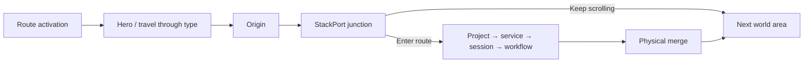

# Switchyard — single-stage prototype

The creative home has one persistent viewport. Its parent supplies virtual scroll distance; no portfolio sections occupy positions down that document. Camera movement and every waypoint transform are sampled from the same smoothed journey clock.

## Current scope

The remaining regions are deliberately deferred. Existing `/projects`, `/about`, `/blogs`, and `/contact` pages remain available through the direct index. They are not stacked underneath the home stage.

## Source responsibilities

- `Journey.tsx`: persistent stage, absolute waypoint overlays, route map and accessible direct index.
- `journey-model.ts`: pure mapping between scroll units, main-route distance, branch progress and active waypoint.
- `useJourneyController.ts`: one smoothed playhead; writes camera state and GSAP depth transforms from the same sample. No section position measurements or vertical entrances.
- `world-path.ts`: Catmull–Rom main centerline and smooth branch curves with matching entry/exit tangents.
- `RouteWorld.tsx`: static world geometry and a perspective camera moving through it. Raw WebGL, not Three.js. Rails, cross-marks, switch rings, ground, survey lines, architectural frames and the first signal share one canvas. DOM tether pins use this camera's actual projection.
- `OpeningSequence.tsx`: activation of that same world, followed by masked DOM type and staggered labels.
- `WorldMap.tsx`: native accessible dialog, branch topology, fast navigation and a bird's-eye view using the same camera.

## Itinerary

One main unit is 0.065 viewport heights. The main path is 100 units. Entry occupies the first 16 units, origin the next 21, and the junction remains available until unit 62. Continuing scroll always takes the main path unless Enter Route was explicitly selected.

Selecting StackPort inserts a 65-unit exploration interval at the physical branch start (world distance 54). Native smooth scrolling advances the master clock into that interval; it does not scroll a project section into view. Branch travel reaches distance 74, then resumes the main route at its matching distance. Reversing scroll retraces the selected itinerary. The branch choice lasts for the current mounted journey only.

Camera orientation samples the curve tangent, including matching tangents at the merge. Typography changes in depth and horizontal registration relative to its waypoint; it never leaves through ordinary document scrolling. Secondary rail edges, switch plates and foreground marks establish depth while the active centerline stays lime. A projected leader connects the current content area to a location on the physical route.

## Opening

First visits use a 2.2-second timeline; repeat visits within 30 minutes in the same tab use 0.8 seconds. A small origin signal activates, the existing route draws forward, secondary geometry and fog register, the real name is unmasked, then labels and the scroll cue arrive. There is no replacement loader canvas. Input can interrupt the intro immediately; reduced motion, restored scroll positions and deep links skip it. Safety timeouts fail open.

## Accessibility and performance

Desktop and mobile both retain the pinned stage. Inactive waypoints are inert and hidden from assistive technology. The map supports M, Escape, native dialog focus containment, and focus restoration. Reduced motion, unavailable WebGL, or disabled JavaScript exposes a compact direct portfolio index, rather than hiding access to the content. Native scrolling is never prevented.

The renderer caps pixel density, lowers resolution under sustained frame pressure, pauses while hidden, and disposes GPU resources. A real phone still needs device testing; browser viewport emulation does not establish mobile GPU performance.

## Verification

`tests/switchyard.mjs` covers pinning, natural bypass, explicit branch entry, product stages, position continuity at merge, reverse travel, canvas identity, canvas-disabled architecture, map, phone viewports, reduced motion, no-WebGL and no-JavaScript direct access.

`tests/switchyard-opening.mjs` checks first/repeat timeline duration and input interruption. Run timing checks separately from video capture so competing browser recordings do not distort wall-clock timings.
